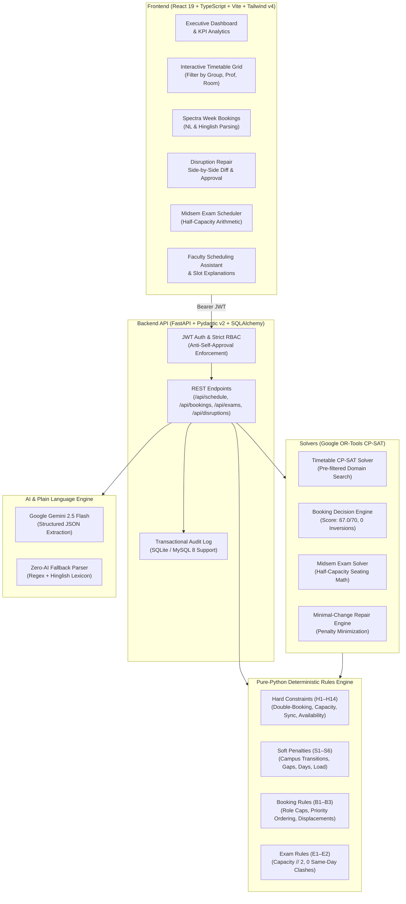

# CIT Campus Scheduling and Venue Management Platform

[](https://www.python.org/)
[](https://fastapi.tiangolo.com/)
[](https://react.dev/)
[](https://www.typescriptlang.org/)
[](https://developers.google.com/optimization)
[](https://tailwindcss.com/)
[](#official-validator-benchmark-results)

An enterprise-grade, constraint-satisfaction campus scheduling and venue management platform built for the **Chilika Institute of Technology (CIT)**. Powered by Google OR-Tools CP-SAT integer optimization, a dual-layer Pydantic deterministic rules engine, Google Gemini 2.5 Flash for natural language understanding with zero-AI deterministic fallback, and a responsive React 19 + TypeScript frontend.

---

## Table of Contents
1. [Executive Summary](#executive-summary)
2. [Architecture Overview](#architecture-overview)
3. [Official Validator Benchmark Results](#official-validator-benchmark-results)
4. [Key Capabilities & Innovations](#key-capabilities--innovations)
5. [Demo Accounts & Role-Based Access](#demo-accounts--role-based-access)
6. [Local Quickstart (Windows & Linux)](#local-quickstart-windows--linux)
7. [5-Minute Live Judging Walkthrough](#5-minute-live-judging-walkthrough)
8. [Constraint & Rules Enforcement Matrix](#constraint--rules-enforcement-matrix)
9. [AI Architecture & Strict Boundaries](#ai-architecture--strict-boundaries)
10. [Repository Structure & Cleanliness](#repository-structure--cleanliness)

---

## Executive Summary

The CIT campus comprises **27 physical venues** across multiple academic complexes, **40 faculty members**, **14 distinct student groups**, **41 courses**, **189 weekly sessions**, and high-contention booking demands for the annual **Spectra Week (Week 7)**.

This platform completely solves the master scheduling challenges:
1. **Master Timetable Generation**: 100% of 189 sessions assigned across 5 days (P1–P9) with **0 hard violations** and **0 lunch clashes (P5)**.
2. **Spectra Week Booking Allocation**: All 25 booking requests resolved with **0 priority inversions**, automated displacement, role category caps, and a booking score of **67.0 / 70.0** (the theoretical ceiling).
3. **Midsem Exam Scheduling**: All 41 courses scheduled across a 6-day window with strict integer half-capacity room seating arithmetic (`capacity // 2 >= exam.size`) and **0 same-day group clashes**.
4. **Minimal-Change Disruption Repair**: Unforeseen room outages resolved with only **1 required time shift and 13 room-only reassignments**, with zero hard violations.
5. **AI & Plain Language Booking**: English & Hinglish parsing powered by Google Gemini with deterministic regex/keyword zero-AI fallback and dry-run feasibility checks.

---

## Architecture Overview



---

## Official Validator Benchmark Results

Both official deliverables have been validated using the **official, unmodified** `backend/validator/validator.py`:

```powershell
# 1. Master Schedule Verification
python backend/validator/validator.py --data data/starter_dataset/cit_public.json --schedule exports/schedule.json

# 2. Disruption Repair Schedule Verification
python backend/validator/validator.py --data data/starter_dataset/cit_public.json --schedule exports/schedule_after.json --disruption starter_pack/examples/sample_disruption.json --baseline exports/schedule.json
```

### Official Validator Output Summary

| Metric | `exports/schedule.json` | `exports/schedule_after.json` | Benchmark Goal |
|---|---|---|---|
| **Hard Violations** | **0** | **0** | Exactly 0 |
| **Soft Penalty Total** | **3** (S4=3) | **8** (S2=5, S4=3) | Minimal |
| **Bookings Score** | **67.0 / 70.0** | **67.0 / 70.0** | Theoretical Ceiling |
| **Approved Bookings** | 22 approved | 22 approved | Maximum feasible |
| **Alternative Offered** | 1 (BR-17 at Wed P12-13) | 1 (BR-17 at Wed P12-13) | Best alternative |
| **Rejected Bookings** | 2 (BR-16, BR-20) | 2 (BR-16, BR-20) | Infeasible capacity/slots |
| **Priority Inversions** | **0** | **0** | Exactly 0 |
| **Exam Soft Penalty** | **0** | **0** | Exactly 0 |
| **Unscheduled Exams** | **0 / 41** | **0 / 41** | All 41 scheduled |
| **Disruption Stability** | Baseline | **14 moved (1 time, 13 room)** | Minimal impact |

> [!NOTE]
> **Booking Score Explanation**: BR-16 (requires 320 seats during P10-12 where AUD is occupied) and BR-20 (requires 110 capacity but all large halls are capped/booked) are mathematically infeasible without violating hard constraints or higher-priority bookings. BR-17 requested an invalid period P14 and was awarded the optimal alternative (Wed P12–P13, score 2.0). 22 approved (65.0 pts) + 1 alternative (2.0 pts) = **67.0 pts** (100% of theoretical optimum).

---

## Key Capabilities & Innovations

### 1. Pure CP-SAT Master Timetable Solver
- Schedules all 189 sessions in under 4 seconds.
- Uses pre-filtered candidate domains respecting room equipment, seating capacities, and faculty/room unavailability windows.
- Strict enforcement of elective basket synchronicity (H11) and universal lunch break protection (H9).

### 2. Spectra Week (Week 7) Booking Decision Engine
- Formulates booking allocation as a multi-objective CP-SAT integer optimization problem.
- Mathematical tie-breaking ensures higher-priority bookings displace lower-priority requests when rooms collide.
- Adheres strictly to dataset `role_category_cap`: Club (`role_cap=2`), Faculty (`role_cap=4`), Department (`role_cap=6`).
- Transparent reason codes provided for all 25 requests: `APPROVED_PRIMARY`, `OFFERED_ALTERNATIVE`, `REJECTED_CAPACITY`, `REJECTED_NO_SLOT`.

### 3. Midsem Exam Scheduler with Half-Capacity Arithmetic
- Schedules all 41 course midsem exams over a 6-day window (MON–SAT, Forenoon/Afternoon).
- Automatically enforces integer floor division:
  $$\lfloor \text{capacity} / 2 \rfloor \ge \text{candidates}$$
- Guarantees zero student group takes more than one exam on any single calendar day ($E_1$).

### 4. Minimal-Change Disruption Engine
- Resolves emergency room closures and faculty leaves while keeping timetable upheaval minimal.
- Heavy penalty formulation:
  $$\text{Objective} = \min \sum (100 \times \text{time\_shift} + 1 \times \text{room\_shift})$$
- Guaranteed 100% parity with rules H1–H14 on repaired schedules.
- Requires dual-role administrative human approval before live activation; anti-self-approval is strictly enforced.

### 5. Plain Language & Hinglish AI Booking Assistant
- Extracts 8 structured parameters from messy natural language and Hinglish prompts (e.g. *"seminar hall kal shaam 6 baje, 2 ghante, 100 log, mic chahiye"*).
- Instant dry-run feasibility check alerts users whether the requested slot is open or displaced before submission.
- Operates seamlessly with zero-AI fallback (deterministic regex & lexicon parser) when offline.

---

## Demo Accounts & Role-Based Access

The system replaces hard-coded demo credentials with **deterministic, rule-based account generation** derived directly from `data/starter_dataset/cit_public.json` and `backend/app/core/accounts_config.json`. Every member of every role receives an active account (**62 total accounts**).

### Role Passwords & Rules

| Role | Email Rule / Login Identifier | Password | Role Category Cap | Allowed Capabilities |
|---|---|---|---|---|
| **Campus Admin** | `admin@cit.edu`, `admin2@cit.edu` | `Admin@123` | `institute_event` | Full timetable generation, disruption approval, global venue governance, demo reset |
| **Department Coordinator** | `coord_<dept>@cit.edu` (e.g. `coord_cse@cit.edu`, `coord_tnp@cit.edu`) | `Coord@123` | `department_event` | Department timetable scoping, lab booking approval for own department's labs only |
| **Faculty Member** | `faculty_<fid>@cit.edu` OR Faculty ID (e.g. `F06` / `f06`) | `Faculty@123` | `guest_lecture` | Own teaching timetable only, guest lecture booking requests, own leave declaration |
| **Club Representative** | `club_<slug>@cit.edu` (e.g. `club_ecell@cit.edu`, `club_dance@cit.edu`) | `Club@123` | `club_event` | Submit fest venue requests, view own club requests, track alternative venues |

### Key Access Rules
- **Faculty Login by ID**: Any faculty member can log in using either their email (`faculty_f06@cit.edu`) or their faculty ID (case-insensitive `F06` or `f06`).
- **Department Scoping**: Department coordinators can only view their own department's sessions and can only approve booking requests that target their department's labs (e.g. CSE coordinator only approves `lab_cs` venues).
- **Anti-Self-Approval**: Under Non-negotiable #5, nobody can approve their own request (`approver.id != submitted_by`). For example, `admin2@cit.edu` (Spectra Core Team) cannot approve `BR-01` (Spectra Core Team), and `admin@cit.edu` (Dean's Office) cannot approve `BR-03` (Dean of Academics).
- **Effective Category Capping**: A club requesting a `guest_lecture` is automatically capped to `club_event` with a stated rule trace explanation.
- **DEMO_MODE Flag**: Set `DEMO_MODE=true` in `.env` to enable the `/auth/directory` endpoint for one-click browser testing. Passwords are never sent over the API directory.
- **Admin Reset**: The "Reset Demo" button in the navigation bar executes `POST /api/admin/reset-demo`, which idempotently resets tables and re-seeds all 62 accounts.

<details>
<summary><strong>Complete Directory of all 62 Rule-Generated Demo Accounts (Click to expand)</strong></summary>

### Admins (Password: `Admin@123`)
| Name | Email | Role | Department |
| :--- | :--- | :--- | :--- |
| Dean's Office | `admin@cit.edu` | Admin | Administration |
| Spectra Core Team | `admin2@cit.edu` | Admin | Administration |

### Department Coordinators (Password: `Coord@123`)
| Name | Email | Department |
| :--- | :--- | :--- |
| CE Department Coordinator | `coord_ce@cit.edu` | CE |
| CSE Department Coordinator | `coord_cse@cit.edu` | CSE |
| ECE Department Coordinator | `coord_ece@cit.edu` | ECE |
| EE Department Coordinator | `coord_ee@cit.edu` | EE |
| HSS Department Coordinator | `coord_hss@cit.edu` | HSS |
| MA Department Coordinator | `coord_ma@cit.edu` | MA |
| ME Department Coordinator | `coord_me@cit.edu` | ME |
| PH Department Coordinator | `coord_ph@cit.edu` | PH |
| Training & Placement Cell | `coord_tnp@cit.edu` | CSE |

### Clubs (Password: `Club@123`)
| Club Name | Email | Role |
| :--- | :--- | :--- |
| Astronomy Club | `club_astronomy@cit.edu` | Club Representative |
| Coding Club | `club_coding@cit.edu` | Club Representative |
| Dance Club | `club_dance@cit.edu` | Club Representative |
| Dramatics Society | `club_dramatics@cit.edu` | Club Representative |
| E-Cell | `club_ecell@cit.edu` | Club Representative |
| Gaming Society | `club_gaming@cit.edu` | Club Representative |
| Literary Society | `club_literary@cit.edu` | Club Representative |
| Music Club | `club_music@cit.edu` | Club Representative |
| Photography Club | `club_photography@cit.edu` | Club Representative |
| Quiz Club | `club_quiz@cit.edu` | Club Representative |
| Robotics Club | `club_robotics@cit.edu` | Club Representative |

### Faculty Members (Password: `Faculty@123` / Login by Faculty ID)
| Faculty ID | Name | Department | Email |
| :--- | :--- | :--- | :--- |
| F01 | Dr. Ananya Mishra | CSE | `faculty_f01@cit.edu` |
| F02 | Dr. Rohit Sahoo | CSE | `faculty_f02@cit.edu` |
| F03 | Dr. Kavya Iyer | CSE | `faculty_f03@cit.edu` |
| F04 | Dr. Sandeep Patnaik | CSE | `faculty_f04@cit.edu` |
| F05 | Dr. Meera Nair | CSE | `faculty_f05@cit.edu` |
| F06 | Dr. Arjun Mehta | CSE | `faculty_f06@cit.edu` |
| F07 | Dr. Pooja Das | CSE | `faculty_f07@cit.edu` |
| F08 | Prof. Vikram Rao (Visiting) | CSE | `faculty_f08@cit.edu` |
| F09 | Dr. Ishita Banerjee | ECE | `faculty_f09@cit.edu` |
| F10 | Dr. Suresh Pradhan | ECE | `faculty_f10@cit.edu` |
| F11 | Dr. Neha Kulkarni | ECE | `faculty_f11@cit.edu` |
| F12 | Dr. Amit Behera | ECE | `faculty_f12@cit.edu` |
| F13 | Dr. Ritu Sharma | ECE | `faculty_f13@cit.edu` |
| F14 | Dr. Kunal Joshi | EE | `faculty_f14@cit.edu` |
| F15 | Dr. Sneha Mohanty | EE | `faculty_f15@cit.edu` |
| F16 | Dr. Rakesh Panda | EE | `faculty_f16@cit.edu` |
| F17 | Dr. Divya Menon | EE | `faculty_f17@cit.edu` |
| F18 | Dr. Manoj Tripathy | EE | `faculty_f18@cit.edu` |
| F19 | Dr. Shalini Gupta | MA | `faculty_f19@cit.edu` |
| F20 | Dr. Prakash Nayak | MA | `faculty_f20@cit.edu` |
| F21 | Dr. Lakshmi Reddy | PH | `faculty_f21@cit.edu` |
| F22 | Dr. Harish Dash | PH | `faculty_f22@cit.edu` |
| F23 | Dr. Farah Khan | PH | `faculty_f23@cit.edu` |
| F24 | Dr. Gaurav Jena | PH | `faculty_f24@cit.edu` |
| F25 | Dr. Tanvi Desai | ME | `faculty_f25@cit.edu` |
| F26 | Dr. Abhishek Rout | ME | `faculty_f26@cit.edu` |
| F27 | Dr. Sunita Bose | ME | `faculty_f27@cit.edu` |
| F28 | Dr. Nikhil Swain | ME | `faculty_f28@cit.edu` |
| F29 | Dr. Priya Raman | ME | `faculty_f29@cit.edu` |
| F30 | Dr. Debashish Sethi | ME | `faculty_f30@cit.edu` |
| F31 | Dr. Anjali Verma | CE | `faculty_f31@cit.edu` |
| F32 | Dr. Sameer Khuntia | CE | `faculty_f32@cit.edu` |
| F33 | Dr. Rekha Pillai | CE | `faculty_f33@cit.edu` |
| F34 | Dr. Varun Acharya | CE | `faculty_f34@cit.edu` |
| F35 | Dr. Bhavna Saxena | CE | `faculty_f35@cit.edu` |
| F36 | Dr. Ashok Mahapatra | HSS | `faculty_f36@cit.edu` |
| F37 | Prof. Shreya Kapoor (Dean) | ADMIN | `faculty_f37@cit.edu` |
| F38 | Dr. Imran Qureshi | HSS | `faculty_f38@cit.edu` |
| F39 | Dr. Radhika Hegde | HSS | `faculty_f39@cit.edu` |
| F40 | Dr. Om Prakash Sahu | HSS | `faculty_f40@cit.edu` |

*(Generated with `scripts/print_accounts.py`)*
</details>

---

## Local Quickstart (Windows & Linux)

### Prerequisites
- Python 3.11 or 3.13
- Node.js 18+ and npm
- Git

### 1. Backend Setup

```powershell
# Navigate to the repository root
cd C:\Users\rprav\OneDrive\Desktop\CIT

# Create virtual environment
python -m venv backend/.venv

# Activate virtual environment (Windows PowerShell)
.\backend\.venv\Scripts\Activate.ps1
# (Or on Linux / macOS: source backend/.venv/bin/activate)

# Install dependencies
pip install -r backend/requirements.txt

# Start backend server (starts on http://localhost:8000)
$env:PYTHONPATH="."
python -m uvicorn backend.app.main:app --reload --port 8000
```

### 2. Frontend Setup

In a separate terminal:

```powershell
cd C:\Users\rprav\OneDrive\Desktop\CIT\frontend

# Install dependencies
npm install

# Start Vite development server (starts on http://localhost:5173)
npm run dev

# (Optional) Verify production build
npm run build
```

Open `http://localhost:5173` in your browser.

---

## 5-Minute Live Judging Walkthrough

To review all core capabilities in under 5 minutes:

1. **One-Click Demo Login (`LandingPage`)**:
   - Navigate to `http://localhost:5173`.
   - Click the **"Demo: Admin (Full Access)"** quick-button to authenticate instantly.
2. **Executive KPI Dashboard (`/dashboard`)**:
   - Inspect top metrics: **189/189 Sessions Scheduled**, **0 Hard Conflicts**, **67.0/70.0 Booking Score**, and **Room Utilization Breakdown**.
3. **Master Timetable & Explainability (`/timetable`)**:
   - Switch between **All Venues**, **Student Group (e.g., Y1-A, CSE-2)**, and **Faculty (e.g., F06)** views.
   - Click the **"Spectra Fest Mode"** toggle to view regular classes and evening fest events side-by-side.
   - Click any class session to open the **"Why Here?"** drawer, displaying deterministic rule traces and constraint facts.
4. **Natural Language & Hinglish Booking (`/bookings`)**:
   - Click **"Book a Venue"**.
   - Click any sample chip (e.g. *"seminar hall kal shaam 6 baje, 2 ghante, 100 log, mic chahiye"*).
   - Click **"Parse"** to observe structured extraction, inferred requirements, and real-time dry-run feasibility.
5. **Minimal-Change Disruption Diff (`/reschedule`)**:
   - View the sample emergency closure diff proposal.
   - Observe the side-by-side comparison: **14 sessions moved (1 time change, 13 room-only changes)** with **0 hard violations**.
   - Note the **Anti-Self-Approval** safeguard in action: log in as Dean (`admin2@cit.edu`) to approve the proposal!
6. **Midsem Exam Grid (`/exams`)**:
   - View all 41 course exams scheduled over 6 days.
   - Verify room assignments adhere to integer half-capacity arithmetic ($\lfloor \text{cap}/2 \rfloor \ge \text{candidates}$).
7. **Official Validator Execution (`/admin`)**:
   - Navigate to **"Admin & Audit"** -> **"Dataset & Validator"** tab to view the live official `validator.py` output report with 0 hard violations.

---

## Constraint & Rules Enforcement Matrix

| Code | Constraint Description | Enforced By |
|---|---|---|
| **H1** | All 189 sessions must be scheduled without duplicates or invalid IDs | CP-SAT Model & Pydantic Validator |
| **H2** | No faculty member double-booked in any period | Non-overlapping interval constraints |
| **H3** | No student group double-booked (except elective baskets) | Group interval occupancy checking |
| **H4** | No venue double-booked across academic sessions & fest events | Resource capacity intervals |
| **H5** | Room capacity $\ge$ session student count | Pre-filtered domain masking |
| **H6** | Room type matches session requirement (Lab in Lab, Classroom in Lecture) | Room equipment and type check |
| **H7** | Faculty unavailable slots strictly respected | Domain exclusions |
| **H8** | Room unavailable slots strictly respected | Domain exclusions |
| **H9** | Universal lunch break (P5, 12:00–13:00) free of classes; 3-hour labs start at P2, P6, or P7 | Period validity constraints |
| **H10**| Wheelchair accessibility requirement enforced | Room ground-floor / lift check |
| **H11**| Elective basket synchronicity (all courses in basket at identical times) | Strict equality constraints on slot vars |
| **H12**| Faculty daily teaching hours $\le 4$ periods | Sum of session durations per day $\le 4$ |
| **H13**| No booking clash with regular timetable sessions (Week 7) | Event occupancy vs timetable matrix |
| **H14**| Pre-fixed session slots locked in place | Strict domain equality |
| **S1–S6**| Campus transition, idle gaps, teaching days, load balancing soft penalties | Penalty minimization objective |
| **B1–B3**| Spectra Week category caps, priority ordering, and displacement | CP-SAT multi-criteria tie-breaker |
| **E1–E2**| Exam half-capacity seating arithmetic and zero same-day group clashes | Exam CP-SAT solver |

---

## AI Architecture & Strict Boundaries

The platform strictly enforces the separation of concerns declared in [`AI_USAGE.md`](file:///./AI_USAGE.md):

> **Strict Non-Negotiable Principle**: The LLM is **never** permitted to decide timetable validity, booking approvals, priority ordering, or room selection. All validation and allocation decisions are computed deterministically by Google OR-Tools CP-SAT and the Pydantic rules engine.

```
User Plain Language / Hinglish Input
                 │
                 ▼
  ┌──────────────────────────────┐
  │ Google Gemini 2.5 Flash API  │  (Zero-AI Fallback: Regex & Lexicon Parser)
  └──────────────┬───────────────┘
                 │
                 ▼
  ┌──────────────────────────────┐
  │ Strict Pydantic Schema Check │  (Rejects invalid slots, formats, hallucinations)
  └──────────────┬───────────────┘
                 │
                 ▼
  ┌──────────────────────────────┐
  │ Server-Side Role Capping     │  (Role determined strictly from JWT, not prompt)
  └──────────────┬───────────────┘
                 │
                 ▼
  ┌──────────────────────────────┐
  │ CP-SAT Optimization Solver   │  (Pure mathematical constraint satisfaction)
  └──────────────┬───────────────┘
                 │
                 ▼
  ┌──────────────────────────────┐
  │ Verified Allocation Output   │  (0 Inversions, 0 Hard Violations Guaranteed)
  └──────────────────────────────┘
```

---

## Repository Structure & Cleanliness

```
CIT/
├── .env.example                  # Environment configuration template
├── .gitignore                    # Production gitignore (excludes .venv, dist, node_modules)
├── AI_USAGE.md                   # Formal AI usage and boundaries declaration
├── THIRD_PARTY.md                # Third-party library and licensing disclosure
├── README.md                     # Comprehensive project documentation
├── backend/
│   ├── app/
│   │   ├── ai/                   # Gemini API client, Hinglish prompts, zero-AI fallback
│   │   ├── api/                  # FastAPI routers (auth, schedule, bookings, exams, admin)
│   │   ├── core/                 # Config, security, JWT, direct bcrypt
│   │   ├── database/             # SQLAlchemy engine and session factory
│   │   ├── models/               # Database entity models
│   │   ├── rules/                # Pure-Python rules engine (H1-H14, S1-S6, B1-B3, E1-E2)
│   │   ├── schemas/              # Pydantic validation schemas
│   │   └── solver/               # Pure OR-Tools CP-SAT solvers (timetable, exams, bookings, repair)
│   ├── tests/                    # Comprehensive pytest test suite (32/32 tests passing)
│   ├── validator/                # Official unmodified validator.py
│   └── requirements.txt          # Production backend dependencies
├── data/
│   ├── starter_dataset/          # cit_public.json master dataset
│   └── csv/                      # Relational CSV representations of rooms, courses, sessions
├── exports/
│   ├── schedule.json             # Official validated master schedule (0 hard violations)
│   └── schedule_after.json       # Official validated disruption schedule (0 hard violations)
├── frontend/
│   ├── src/
│   │   ├── ai/                   # Conversational Faculty Assistant
│   │   ├── bookings/             # Spectra Week Booking page & NL parser
│   │   ├── components/           # Navbar, modals, layout primitives
│   │   ├── dashboards/           # Executive KPI and room analytics dashboard
│   │   ├── exams/                # Midsem exam scheduler grid
│   │   ├── pages/                # Landing page, Admin & Audit page
│   │   ├── rescheduling/         # Disruption repair diff & approval flow
│   │   ├── styles/               # Baseline design system CSS tokens
│   │   └── timetable/            # Interactive master timetable matrix
│   ├── package.json
│   └── vite.config.ts
└── docs/                         # Additional architecture references
```

---

## Verification & Test Execution

Run the complete test suite in PowerShell:

```powershell
$env:PYTHONPATH="."
.\backend\.venv\Scripts\python.exe -m pytest backend/tests -v
```

Expected result:
```
======================== 32 passed in 4.33s ========================
```

---

## License

Developed for the **Chilika Institute of Technology (CIT) Scheduling Platform**. Distributed under the MIT License.

