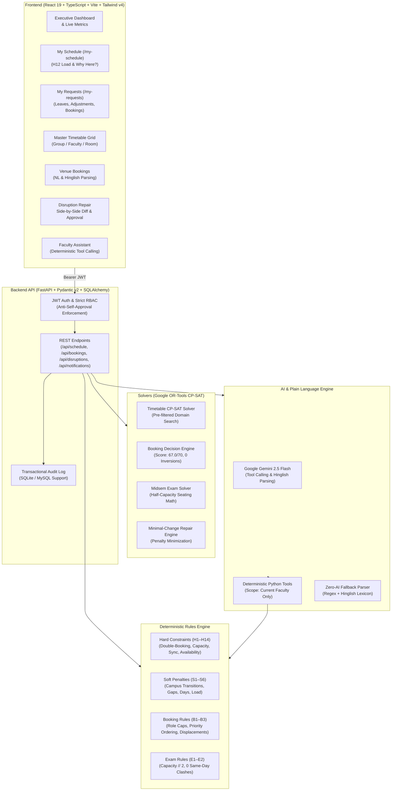

# CIT Campus Scheduling and Venue Management Platform

[](https://www.python.org/)
[](https://fastapi.tiangolo.com/)
[](https://react.dev/)
[](https://www.typescriptlang.org/)
[](https://developers.google.com/optimization)
[](https://tailwindcss.com/)
[](#official-validator-benchmark-results)

An enterprise-grade, constraint-satisfaction campus scheduling and venue management platform built for the **Chilika Institute of Technology (CIT)**. Powered by Google OR-Tools CP-SAT integer optimization, a dual-layer pure-Python deterministic rules engine, Google Gemini 2.5 Flash for conversational understanding with zero-AI deterministic fallback, and a high-performance React 19 + TypeScript frontend.

---

## Table of Contents
1. [Executive Summary](#executive-summary)
2. [Architecture Overview](#architecture-overview)
3. [Official Validator Benchmark Results](#official-validator-benchmark-results)
4. [Enhanced Faculty Role Experience](#enhanced-faculty-role-experience)
5. [Key Capabilities & Solvers](#key-capabilities--solvers)
6. [Demo Accounts & Role-Based Access](#demo-accounts--role-based-access)
7. [API Endpoints Reference](#api-endpoints-reference)
8. [Local Quickstart (Windows & Linux)](#local-quickstart-windows--linux)
9. [5-Minute Live Judging Walkthrough](#5-minute-live-judging-walkthrough)
10. [Constraint & Rules Enforcement Matrix](#constraint--rules-enforcement-matrix)
11. [AI Architecture & Strict Boundaries](#ai-architecture--strict-boundaries)
12. [Repository Structure & Cleanliness](#repository-structure--cleanliness)
13. [Verification & Test Execution](#verification--test-execution)

---

## Executive Summary

The CIT campus comprises **27 physical venues** across multiple academic complexes, **40 faculty members**, **14 distinct student groups**, **41 courses**, **189 weekly sessions**, and high-contention booking demands for the annual **Spectra Week (Week 7)**.

This platform completely solves the master scheduling challenges:
1. **Master Timetable Generation**: 100% of 189 sessions assigned across 5 days (P1–P9) with **0 hard violations** and **0 lunch clashes (P5)**.
2. **Spectra Week Booking Allocation**: All 25 booking requests resolved with **0 priority inversions**, automated displacement, role category caps, and a booking score of **67.0 / 70.0** (the theoretical ceiling).
3. **Midsem Exam Scheduling**: All 41 courses scheduled across a 6-day window with strict integer half-capacity room seating arithmetic (`capacity // 2 >= exam.size`) and **0 same-day group clashes**.
4. **Minimal-Change Disruption Repair**: Unforeseen room outages and faculty leaves resolved with minimal time shifts and room-only reassignments, with zero hard violations.
5. **Enhanced Faculty Experience**: Full role-gated faculty portal with weekly schedule view, daily workload meter (H12), unavailability declarations with dry-run solver preview, request tracking, in-app notifications, and a tool-calling AI assistant.

---

## Architecture Overview



---

## Official Validator Benchmark Results

Both official deliverables have been validated using the **official, unmodified** `backend/validator/validator.py`:

```powershell
# 1. Master Schedule Verification
python backend/validator/validator.py --data data/starter_dataset/cit_public.json --schedule exports/schedule.json

# 2. Disruption Repair Schedule Verification
python backend/validator/validator.py --data data/starter_dataset/cit_public.json --schedule exports/schedule_after.json --disruption starter_pack/examples/sample_disruption.json --baseline exports/schedule.json
```

### Official Validator Output Summary

| Metric | `exports/schedule.json` | `exports/schedule_after.json` | Benchmark Goal |
|---|---|---|---|
| **Hard Violations** | **0** | **0** | Exactly 0 |
| **Soft Penalty Total** | **3** (S4=3) | **8** (S2=5, S4=3) | Minimal |
| **Bookings Score** | **67.0 / 70.0** | **67.0 / 70.0** | Theoretical Ceiling |
| **Approved Bookings** | 22 approved | 22 approved | Maximum feasible |
| **Alternative Offered** | 1 (BR-17 at Wed P12-13) | 1 (BR-17 at Wed P12-13) | Best alternative |
| **Rejected Bookings** | 2 (BR-16, BR-20) | 2 (BR-16, BR-20) | Infeasible capacity/slots |
| **Priority Inversions** | **0** | **0** | Exactly 0 |
| **Exam Soft Penalty** | **0** | **0** | Exactly 0 |
| **Unscheduled Exams** | **0 / 41** | **0 / 41** | All 41 scheduled |
| **Disruption Stability** | Baseline | **14 moved (1 time, 13 room)** | Minimal impact |

> [!NOTE]
> **Booking Score Explanation**: BR-16 (requires 320 seats during P10-12 where AUD is occupied) and BR-20 (requires 110 capacity but all large halls are capped/booked) are mathematically infeasible without violating hard constraints or higher-priority bookings. BR-17 requested an invalid period P14 and was awarded the optimal alternative (Wed P12–P13, score 2.0). 22 approved (65.0 pts) + 1 alternative (2.0 pts) = **67.0 pts** (100% of theoretical optimum).

---

## Enhanced Faculty Role Experience

The faculty experience (`role="faculty"`) provides dedicated, role-gated workflows designed specifically for academic faculty. All features are verified against ground-truth data with **zero hardcoded placeholders**:

- **Demo Faculty Account**: `faculty_f06@cit.edu` / `Faculty@123` (Prof. Sharma, Faculty ID `F06`, Computer Science & Engineering).
- **"My Schedule" View (`/my-schedule`)**:
  - Weekly synchronized timetable grid filtered strictly to the logged-in faculty's sessions.
  - Live daily teaching workload meter evaluated against rule **H12** (`max_hours_per_day`, 4h limit for F06).
  - Computed free periods per day to facilitate office hours and research.
  - **"Why here?" Modal**: Real constraint explanation showing exact reasons for slot placement, campus conflicts avoided, and computed legal slot options (e.g. 267 legal alternatives for `CS202-L1`) ranked by minimal soft penalty delta.
- **Unavailability & Leave Declaration with Dry-Run Solver**:
  - Date/day + period picker with reason documentation.
  - **Dry-run CP-SAT solver preview**: Computes minimal-change repair impact, affected sessions, and rule compliance before submitting to the Admin approval queue.
- **"My Requests & Approvals" View (`/my-requests`)**:
  - Unified tracking across **Leave Declarations**, **Class Move/Extra Requests**, and **Venue Bookings**.
  - Real status badges (`Pending Review`, `Approved & Applied`, `Alternative Offered`, `Rejected`), reason codes, and audit trail.
  - Class adjustment modal for requesting moved sessions or proposing extra lectures.
- **AI Faculty Assistant (`/assistant`) with Deterministic Tool Calling**:
  - Grounded by `backend/app/ai/prompts/faculty_assistant.txt`.
  - Tools call deterministic code: `resolve_faculty_session`, `tool_explain_session`, `tool_find_free_rooms`, `tool_propose_reschedule`, `tool_show_my_schedule`, `tool_check_workload`.
  - Model never hallucinates slots or rooms; all proposed slots come directly from the solver and rules engine.
  - Natural language & Hinglish resolution: *"mera DBMS class kal shift kar do, bahar jaana hai"* correctly maps to F06's Tuesday session `CS202-T1` and returns pre-verified alternatives with 0 hard violations.
  - Robust adversarial defenses against Dean authority spoofing, room clash bypasses, cross-faculty tampering, and prompt injections.
  - Seamless offline fallback with `is_fallback: true` UI badge when Gemini API key is unset.
- **In-App Notifications**:
  - Role-aware notification bell in the top navigation bar with unread counters.
  - Instant notifications delivered when admin approves a disruption or proposal affecting the faculty member's sessions.
- **Strict Security & Anti-Self-Approval**:
  - Role, identity, and faculty scoping derived strictly from cryptographically verified server-side JWT.
  - Faculty booking requests are hard-capped server-side to `"guest_lecture"`.
  - Anti-self-approval prevents any user from approving their own disruption reports or proposals.
  - Faculty cannot move sessions directly, re-solve schedules, or access administrative endpoints.

---

## Key Capabilities & Solvers

### 1. Pure CP-SAT Master Timetable Solver
- Schedules all 189 sessions in under 4 seconds.
- Uses pre-filtered candidate domains respecting room equipment, seating capacities, and faculty/room unavailability windows.
- Strict enforcement of elective basket synchronicity (H11) and universal lunch break protection (H9).

### 2. Spectra Week (Week 7) Booking Decision Engine
- Formulates booking allocation as a multi-objective CP-SAT integer optimization problem.
- Mathematical tie-breaking ensures higher-priority bookings displace lower-priority requests when rooms collide.
- Adheres strictly to dataset `role_category_cap`: Club (`role_cap=2`), Faculty (`role_cap=4`), Department (`role_cap=6`).
- Transparent reason codes provided for all 25 requests: `APPROVED_PRIMARY`, `OFFERED_ALTERNATIVE`, `REJECTED_CAPACITY`, `REJECTED_NO_SLOT`.

### 3. Midsem Exam Scheduler with Half-Capacity Arithmetic
- Schedules all 41 course midsem exams over a 6-day window (MON–SAT, Forenoon/Afternoon).
- Automatically enforces integer floor division:
  $$\lfloor \text{capacity} / 2 \rfloor \ge \text{candidates}$$
- Guarantees zero student group takes more than one exam on any single calendar day ($E_1$).

### 4. Minimal-Change Disruption Engine
- Resolves emergency room closures and faculty leaves while keeping timetable upheaval minimal.
- Heavy penalty formulation:
  $$\text{Objective} = \min \sum (100 \times \text{time\_shift} + 1 \times \text{room\_shift})$$
- Guaranteed 100% parity with rules H1–H14 on repaired schedules.
- Full atomic activation upon approval: updates database, `exports/schedule.json`, `exports/schedule_after.json`, and re-solves fest bookings.

---

### 5. Plain Language & Hinglish AI Booking Assistant
- Extracts 8 structured parameters from messy natural language and Hinglish prompts (e.g. *"seminar hall kal shaam 6 baje, 2 ghante, 100 log, mic chahiye"*).
- Instant dry-run feasibility check alerts users whether the requested slot is open or displaced before submission.
- Operates seamlessly with zero-AI fallback (deterministic regex & lexicon parser) when offline.

---

## Demo Accounts & Role-Based Access

The platform features a **rule-based dynamic account system** that generates and seeds authorized login accounts for **every member of every role directly from the dataset (`data/starter_dataset/cit_public.json`)** and external account configuration (`backend/app/core/accounts_config.json`).

### Key Principles & Rules
1. **Zero Hard-Coded People in Python**: Admin accounts and special coordinators (e.g. Training & Placement Cell) are loaded from `accounts_config.json`.
2. **Every Faculty Member (40 Accounts)**: `faculty_<id lowercase>@cit.edu` with name and department directly from the dataset (e.g. `faculty_f06@cit.edu` is `Dr. Arjun Mehta`, CSE). Faculty can also log in directly using their Faculty ID (e.g. `F06` or `f06`).
3. **Every Department Coordinator (9 Accounts)**: `coord_<dept lowercase>@cit.edu` for all academic departments (CE, CSE, ECE, EE, HSS, MA, ME, PH) plus `coord_tnp@cit.edu` (Training & Placement Cell, CSE).
4. **Every Student Club (11 Accounts)**: `club_<slug>@cit.edu` for each distinct club requester in `booking_requests` (slug = lowercase alphanumerics with "club" and "society" stripped).
5. **Campus Administrators (2 Accounts)**: `admin@cit.edu` ("Dean's Office") and `admin2@cit.edu` ("Spectra Core Team").
6. **Environment Variable `DEMO_MODE=true`**: Enables the safe `/auth/directory` endpoint for one-click demo navigation in development and judging. Passwords are never returned over the API.
7. **Idempotent Reset**: The Admin "Reset demo data" button (or `POST /api/admin/reset-demo`) restores the database to the clean starter baseline and guarantees all 62 accounts are re-seeded.

### Role Passwords & Capabilities Table

| Role | Scope & Permissions | Demo Password | Email / Identifier Pattern | Priority Ceiling |
| :--- | :--- | :--- | :--- | :--- |
| **Campus Admin** | Full schedule generation, disruption approval, system reset | `Admin@123` | `admin@cit.edu`, `admin2@cit.edu` | `institute_event` |
| **Department Coordinator** | Department timetable ownership, lab booking approval, session moves | `Coord@123` | `coord_<dept>@cit.edu`, `coord_tnp@cit.edu` | `department_event` |
| **Faculty Member** | Personal timetable, unavailability requests, guest lecture bookings | `Faculty@123` | `faculty_<fid>@cit.edu` or Faculty ID (`F01`–`F40`) | `guest_lecture` |
| **Club Representative** | Student event booking requests, venue availability tracking | `Club@123` | `club_<slug>@cit.edu` | `club_event` |

<details>
<summary><strong>Click to expand all 62 rule-generated demo accounts</strong></summary>

| # | Role | Name | Dept | ID / Slug | Email (or Login Identifier) | Password |
| :--- | :--- | :--- | :--- | :--- | :--- | :--- |
| 1 | Admin | Dean's Office | Administration | - | `admin@cit.edu` | `Admin@123` |
| 2 | Admin | Spectra Core Team | Administration | - | `admin2@cit.edu` | `Admin@123` |
| 3 | Coordinator | CE Department Coordinator | CE | - | `coord_ce@cit.edu` | `Coord@123` |
| 4 | Coordinator | CSE Department Coordinator | CSE | - | `coord_cse@cit.edu` | `Coord@123` |
| 5 | Coordinator | ECE Department Coordinator | ECE | - | `coord_ece@cit.edu` | `Coord@123` |
| 6 | Coordinator | EE Department Coordinator | EE | - | `coord_ee@cit.edu` | `Coord@123` |
| 7 | Coordinator | HSS Department Coordinator | HSS | - | `coord_hss@cit.edu` | `Coord@123` |
| 8 | Coordinator | MA Department Coordinator | MA | - | `coord_ma@cit.edu` | `Coord@123` |
| 9 | Coordinator | ME Department Coordinator | ME | - | `coord_me@cit.edu` | `Coord@123` |
| 10 | Coordinator | PH Department Coordinator | PH | - | `coord_ph@cit.edu` | `Coord@123` |
| 11 | Coordinator | Training & Placement Cell | CSE | - | `coord_tnp@cit.edu` | `Coord@123` |
| 12 | Faculty | Dr. Ananya Mishra | CSE | F01 | `faculty_f01@cit.edu` | `Faculty@123` |
| 13 | Faculty | Dr. Rohit Sahoo | CSE | F02 | `faculty_f02@cit.edu` | `Faculty@123` |
| 14 | Faculty | Dr. Kavya Iyer | CSE | F03 | `faculty_f03@cit.edu` | `Faculty@123` |
| 15 | Faculty | Dr. Sandeep Patnaik | CSE | F04 | `faculty_f04@cit.edu` | `Faculty@123` |
| 16 | Faculty | Dr. Meera Nair | CSE | F05 | `faculty_f05@cit.edu` | `Faculty@123` |
| 17 | Faculty | Dr. Arjun Mehta | CSE | F06 | `faculty_f06@cit.edu` | `Faculty@123` |
| 18 | Faculty | Dr. Pooja Das | CSE | F07 | `faculty_f07@cit.edu` | `Faculty@123` |
| 19 | Faculty | Prof. Vikram Rao (Visiting) | CSE | F08 | `faculty_f08@cit.edu` | `Faculty@123` |
| 20 | Faculty | Dr. Ishita Banerjee | ECE | F09 | `faculty_f09@cit.edu` | `Faculty@123` |
| 21 | Faculty | Dr. Suresh Pradhan | ECE | F10 | `faculty_f10@cit.edu` | `Faculty@123` |
| 22 | Faculty | Dr. Neha Kulkarni | ECE | F11 | `faculty_f11@cit.edu` | `Faculty@123` |
| 23 | Faculty | Dr. Amit Behera | ECE | F12 | `faculty_f12@cit.edu` | `Faculty@123` |
| 24 | Faculty | Dr. Ritu Sharma | ECE | F13 | `faculty_f13@cit.edu` | `Faculty@123` |
| 25 | Faculty | Dr. Kunal Joshi | EE | F14 | `faculty_f14@cit.edu` | `Faculty@123` |
| 26 | Faculty | Dr. Sneha Mohanty | EE | F15 | `faculty_f15@cit.edu` | `Faculty@123` |
| 27 | Faculty | Dr. Rakesh Panda | EE | F16 | `faculty_f16@cit.edu` | `Faculty@123` |
| 28 | Faculty | Dr. Divya Menon | EE | F17 | `faculty_f17@cit.edu` | `Faculty@123` |
| 29 | Faculty | Dr. Manoj Tripathy | EE | F18 | `faculty_f18@cit.edu` | `Faculty@123` |
| 30 | Faculty | Dr. Shalini Gupta | MA | F19 | `faculty_f19@cit.edu` | `Faculty@123` |
| 31 | Faculty | Dr. Prakash Nayak | MA | F20 | `faculty_f20@cit.edu` | `Faculty@123` |
| 32 | Faculty | Dr. Lakshmi Reddy | PH | F21 | `faculty_f21@cit.edu` | `Faculty@123` |
| 33 | Faculty | Dr. Harish Dash | PH | F22 | `faculty_f22@cit.edu` | `Faculty@123` |
| 34 | Faculty | Dr. Farah Khan | PH | F23 | `faculty_f23@cit.edu` | `Faculty@123` |
| 35 | Faculty | Dr. Gaurav Jena | PH | F24 | `faculty_f24@cit.edu` | `Faculty@123` |
| 36 | Faculty | Dr. Tanvi Desai | ME | F25 | `faculty_f25@cit.edu` | `Faculty@123` |
| 37 | Faculty | Dr. Abhishek Rout | ME | F26 | `faculty_f26@cit.edu` | `Faculty@123` |
| 38 | Faculty | Dr. Sunita Bose | ME | F27 | `faculty_f27@cit.edu` | `Faculty@123` |
| 39 | Faculty | Dr. Nikhil Swain | ME | F28 | `faculty_f28@cit.edu` | `Faculty@123` |
| 40 | Faculty | Dr. Priya Raman | ME | F29 | `faculty_f29@cit.edu` | `Faculty@123` |
| 41 | Faculty | Dr. Debashish Sethi | ME | F30 | `faculty_f30@cit.edu` | `Faculty@123` |
| 42 | Faculty | Dr. Anjali Verma | CE | F31 | `faculty_f31@cit.edu` | `Faculty@123` |
| 43 | Faculty | Dr. Sameer Khuntia | CE | F32 | `faculty_f32@cit.edu` | `Faculty@123` |
| 44 | Faculty | Dr. Rekha Pillai | CE | F33 | `faculty_f33@cit.edu` | `Faculty@123` |
| 45 | Faculty | Dr. Varun Acharya | CE | F34 | `faculty_f34@cit.edu` | `Faculty@123` |
| 46 | Faculty | Dr. Bhavna Saxena | CE | F35 | `faculty_f35@cit.edu` | `Faculty@123` |
| 47 | Faculty | Dr. Ashok Mahapatra | HSS | F36 | `faculty_f36@cit.edu` | `Faculty@123` |
| 48 | Faculty | Prof. Shreya Kapoor (Dean) | ADMIN | F37 | `faculty_f37@cit.edu` | `Faculty@123` |
| 49 | Faculty | Dr. Imran Qureshi | HSS | F38 | `faculty_f38@cit.edu` | `Faculty@123` |
| 50 | Faculty | Dr. Radhika Hegde | HSS | F39 | `faculty_f39@cit.edu` | `Faculty@123` |
| 51 | Faculty | Dr. Om Prakash Sahu | HSS | F40 | `faculty_f40@cit.edu` | `Faculty@123` |
| 52 | Club | Coding Club | - | coding | `club_coding@cit.edu` | `Club@123` |
| 53 | Club | Robotics Club | - | robotics | `club_robotics@cit.edu` | `Club@123` |
| 54 | Club | Dance Club | - | dance | `club_dance@cit.edu` | `Club@123` |
| 55 | Club | Quiz Club | - | quiz | `club_quiz@cit.edu` | `Club@123` |
| 56 | Club | Dramatics Society | - | dramatics | `club_dramatics@cit.edu` | `Club@123` |
| 57 | Club | Gaming Society | - | gaming | `club_gaming@cit.edu` | `Club@123` |
| 58 | Club | Photography Club | - | photography | `club_photography@cit.edu` | `Club@123` |
| 59 | Club | E-Cell | - | ecell | `club_ecell@cit.edu` | `Club@123` |
| 60 | Club | Literary Society | - | literary | `club_literary@cit.edu` | `Club@123` |
| 61 | Club | Music Club | - | music | `club_music@cit.edu` | `Club@123` |
| 62 | Club | Astronomy Club | - | astronomy | `club_astronomy@cit.edu` | `Club@123` |

</details>

---

### Dedicated Club Representative Experience
- **Privacy-Preserving Venue Grid (`ClubTimetable.tsx`)**: Renders a dedicated timetable matrix for club reps that strictly masks academic details (no teacher names, no group names, no other club event titles) while revealing venue state (free, class, exam, maintenance, booked, mine).
- **One-Click Pre-filled Booking**: Clicking any free slot in the venue matrix directly opens the booking modal with venue ID, day, period, and duration already pre-filled.
- **Venue Availability Endpoints (`/api/rooms/availability`)**: Dedicated backend router delivering matrix data filtered by week (Week 7 Spectra vs regular weeks) and event periods (P10–P13).

---

## API Endpoints Reference

### Faculty Role Endpoints

| Method | Endpoint | Auth Role | Description |
|---|---|---|---|
| `GET` | `/api/schedule/faculty/my-schedule` | `faculty` | Returns weekly schedule, daily workload vs H12, and free periods for the authenticated faculty. |
| `GET` | `/api/schedule/sessions/{sid}/explain` | Authenticated | Explains why a session is scheduled in its slot. Scoped to faculty's own sessions if role is `faculty`. |
| `GET` | `/api/disruptions/mine` | Authenticated | Lists all disruptions / leave declarations reported by the current user. |
| `POST` | `/api/disruptions/dry-run` | Authenticated | Runs CP-SAT repair engine in simulation mode without updating the database. |
| `GET` | `/api/session-requests/mine` | Authenticated | Lists class move and extra lecture requests submitted by the current faculty member. |
| `POST` | `/api/session-requests` | `faculty` / `admin` | Submits a request to move an existing class or propose an extra lecture. |
| `GET` | `/api/bookings/mine` | Authenticated | Lists venue bookings submitted by the user, with status and solver decision reasons. |
| `GET` | `/api/notifications` | Authenticated | Returns in-app notifications and unread counter for the current user. |
| `POST` | `/api/notifications/{id}/read` | Authenticated | Marks a specific notification as read. |
| `POST` | `/api/notifications/read-all` | Authenticated | Marks all unread notifications as read. |
| `POST` | `/api/ai/chat` | Authenticated | Faculty conversational assistant with function calling and deterministic zero-AI fallback. |

### Core Optimization Endpoints

| Method | Endpoint | Auth Role | Description |
|---|---|---|---|
| `GET` | `/api/schedule` | Public/Optional | Master timetable view. Scoped to faculty's sessions when logged in as faculty. |
| `POST` | `/api/schedule/generate` | `admin` | Runs CP-SAT solver to generate optimal master timetable. |
| `POST` | `/api/bookings/decide-all` | `admin` | Runs Week 7 booking solver across all 25 requests (Score 67.0/70). |
| `POST` | `/api/disruptions/proposals/{id}/approve` | `admin` | Atomically validates, applies, and exports repaired schedule; enforces anti-self-approval. |
| `POST` | `/api/admin/reset-demo` | Public/Admin | Idempotently resets database to pristine starter baseline with seeded demo accounts. |

---

## Local Quickstart (Windows & Linux)

### Prerequisites
- Python 3.11, 3.12, 3.13, or 3.14
- Node.js 18+ and npm
- Git

### 1. Backend Setup

```powershell
# Navigate to the repository root
cd d:\Project\repo\CampusSchedulingAndVenueManagement

# Create virtual environment
python -m venv backend/.venv

# Activate virtual environment (Windows PowerShell)
.\backend\.venv\Scripts\Activate.ps1
# (Or on Linux / macOS: source backend/.venv/bin/activate)

# Install dependencies
pip install -r backend/requirements.txt

# Start backend server (starts on http://localhost:8000)
$env:PYTHONPATH="."
python -m uvicorn backend.app.main:app --reload --port 8000
```

### 2. Frontend Setup

In a separate terminal:

```powershell
cd d:\Project\repo\CampusSchedulingAndVenueManagement\frontend

# Install dependencies
npm install

# Start Vite development server (starts on http://localhost:5173)
npm run dev

# (Optional) Verify production build
npm run build
```

Open `http://localhost:5173` in your browser.

---

## 5-Minute Live Judging Walkthrough

To review all core capabilities in under 5 minutes:

1. **One-Click Demo Login (`LandingPage`)**:
   - Navigate to `http://localhost:5173`.
   - Click the **"Demo: Admin (Full Access)"** quick-button to authenticate instantly.
2. **Executive KPI Dashboard (`/dashboard`)**:
   - Inspect top metrics: **189/189 Sessions Scheduled**, **0 Hard Conflicts**, **67.0/70.0 Booking Score**, and **Room Utilization Breakdown**.
3. **Master Timetable & Explainability (`/timetable`)**:
   - Switch between **All Venues**, **Student Group (e.g., Y1-A, CSE-2)**, and **Faculty (e.g., F06)** views.
   - Click the **"Spectra Fest Mode"** toggle to view regular classes and evening fest events side-by-side.
   - Click any class session to open the **"Why Here?"** drawer, displaying deterministic rule traces and constraint facts.
4. **Natural Language & Hinglish Booking (`/bookings`)**:
   - Click **"Book a Venue"**.
   - Click any sample chip (e.g. *"seminar hall kal shaam 6 baje, 2 ghante, 100 log, mic chahiye"*).
   - Click **"Parse"** to observe structured extraction, inferred requirements, and real-time dry-run feasibility.
5. **Minimal-Change Disruption Diff (`/reschedule`)**:
   - View the sample emergency closure diff proposal.
   - Observe the side-by-side comparison: **14 sessions moved (1 time change, 13 room-only changes)** with **0 hard violations**.
   - Note the **Anti-Self-Approval** safeguard in action: log in as Dean (`admin2@cit.edu`) to approve the proposal!
6. **Midsem Exam Grid (`/exams`)**:
   - View all 41 course exams scheduled over 6 days.
   - Verify room assignments adhere to integer half-capacity arithmetic ($\lfloor \text{cap}/2 \rfloor \ge \text{candidates}$).
7. **Official Validator Execution (`/admin`)**:
   - Navigate to **"Admin & Audit"** -> **"Dataset & Validator"** tab to view the live official `validator.py` output report with 0 hard violations.
8. **Faculty Portal (`/my-schedule`, `/my-requests`)**:
   - Log in as a faculty user to see the weekly schedule with the daily workload meter (H12) and "Why Here?" traces.
   - Declare an unavailability / leave, review the dry-run solver preview, and track it under **My Requests**; approvals surface as in-app notifications.

---

## Constraint & Rules Enforcement Matrix

| Rule Code | Category | Name | Engine Mechanism | Guarantee |
|---|---|---|---|---|
| **H1** | Hard | Valid Session Assignment | CP-SAT Boolean sum = 1 | 0 Missing / Unknown sessions |
| **H2** | Hard | Faculty Double-Booking | Interval overlap constraint | 0 Faculty double-bookings |
| **H3** | Hard | Student Group Double-Booking | Interval overlap constraint | 0 Group double-bookings |
| **H4** | Hard | Room Double-Booking | Cumulative resource limit = 1 | 0 Venue double-bookings |
| **H5** | Hard | Room Capacity Limits | Pre-filtered domain: `capacity >= size` | 0 Overcrowded rooms |
| **H6** | Hard | Room Type Suitability | Pre-filtered domain: `r.type in s.types` | 0 Invalid room types |
| **H7** | Hard | Faculty Unavailability | Pre-filtered domain exclusions | 0 Unavailability clashes |
| **H8** | Hard | Room Maintenance Unavailability | Pre-filtered domain exclusions | 0 Inactive venue assignments |
| **H9** | Hard | Lunch Break Protection | P5 barred for lectures & labs | 0 Lunch break infringements |
| **H10** | Hard | Wheelchair Accessibility | Filter `r.accessible` for tagged needs | 100% Mobility compliance |
| **H11** | Hard | Basket Synchronicity | Equal start period vars across basket | 100% Elective synchrony |
| **H12** | Hard | Faculty Daily Hours Limit | Daily duration sum $\le \text{max\_hours}$ | 0 Workload limit violations |
| **H13** | Hard | Consecutive Session Limits | Max consecutive periods constraint | 0 Exhaustion violations |
| **H14** | Hard | Fixed Slot Enforcement | Bound domain to $(d_0, p_0)$ | 100% Fixed slot fidelity |
| **B1–B3**| Fest | Priority & Inversion Prevention | Strict lexicographic CP-SAT objective | 0 Priority inversions |
| **E1–E2**| Exam | Half-Capacity & Group Spread | Arithmetic $\lfloor \text{cap}/2 \rfloor \ge \text{size}$ | 0 Same-day group exam clashes |

---

## AI Architecture & Strict Boundaries

The platform enforces a strict separation between generative AI and deterministic optimization:

```
┌────────────────────────────────────────────────────────┐
│             User Input (English / Hinglish)            │
└───────────────────────────┬────────────────────────────┘
                            │
                            ▼
┌────────────────────────────────────────────────────────┐
│     Google Gemini 2.5 Flash / Zero-AI Regex Fallback   │  (Parsing, Intent Classification,
└───────────────────────────┬────────────────────────────┘   Conversational Framing ONLY)
                            │
                            ▼
┌────────────────────────────────────────────────────────┐
│            Deterministic Scoped Python Tools           │  (resolve_faculty_session,
└───────────────────────────┬────────────────────────────┘   tool_explain_session, etc.)
                            │
                            ▼
┌────────────────────────────────────────────────────────┐
│          Google OR-Tools CP-SAT & Rules Engine         │  (Pure Mathematical Optimization,
└───────────────────────────┬────────────────────────────┘   Validator.py Parity)
                            │
                            ▼
┌────────────────────────────────────────────────────────┐
│         Verified Schedule Diff & Proposal Card         │  (0 Hard Violations Guaranteed,
└────────────────────────────────────────────────────────┘   Dual Admin Approval Required)
```

See [`AI_USAGE.md`](AI_USAGE.md) for full architectural declarations.

---

## Repository Structure & Cleanliness

```
CampusSchedulingAndVenueManagement/
├── .env.example                  # Environment configuration template
├── .gitignore                    # Production gitignore (excludes .venv, dist, node_modules)
├── AI_USAGE.md                   # Formal AI usage and boundaries declaration
├── THIRD_PARTY.md                # Third-party library and licensing disclosure
├── README.md                     # Comprehensive project documentation
├── Problem_statement.pdf         # Original problem statement
├── CrunchWeek_StarterPack.zip    # Original organiser starter pack (archive)
├── starter_pack/                 # Extracted starter pack (examples, sample disruption, validator)
├── backend/
│   ├── app/
│   │   ├── ai/                   # Gemini client, prompts, zero-AI fallback, faculty tool-calling
│   │   ├── api/                  # FastAPI routers (auth, schedule, bookings, exams, disruptions,
│   │   │                         #   notifications, session_requests, admin, ai, exports, dataset)
│   │   ├── core/                 # Config, security, JWT, direct bcrypt
│   │   ├── database/             # SQLAlchemy engine and session factory
│   │   ├── models/               # Database entity models
│   │   ├── rules/                # Deterministic rules engine (H1-H14, S1-S6, B1-B3, E1-E2, faculty checks)
│   │   ├── schemas/              # Pydantic validation schemas
│   │   └── solver/               # OR-Tools CP-SAT solvers (timetable, exams, bookings, repair)
│   ├── tests/                    # Pytest suite (rules engine, faculty, AI parser, RBAC)
│   ├── validator/                # Official unmodified validator.py
│   └── requirements.txt          # Production backend dependencies
├── data/
│   ├── starter_dataset/          # cit_public.json master dataset
│   └── csv/                      # Relational CSV representations of rooms, courses, sessions
├── exports/
│   ├── schedule.json             # Official validated master schedule (0 hard violations)
│   └── schedule_after.json       # Official validated disruption schedule (0 hard violations)
└── frontend/
    ├── src/
    │   ├── ai/                   # Conversational Faculty Assistant
    │   ├── bookings/             # Venue booking page & NL parser
    │   ├── components/           # Navbar, Toast, layout primitives
    │   ├── dashboards/           # Executive KPI and room analytics dashboard
    │   ├── exams/                # Midsem exam scheduler grid
    │   ├── faculty/              # My Schedule and My Requests pages
    │   ├── pages/                # Landing page, Admin & Audit page
    │   ├── rescheduling/         # Disruption repair diff & approval flow
    │   ├── styles/               # Design system CSS tokens
    │   └── timetable/            # Interactive master timetable matrix
    ├── package.json
    └── vite.config.ts
```

---

## Verification & Test Execution

Run the complete test suite in PowerShell:

```powershell
$env:PYTHONPATH="."
.\backend\.venv\Scripts\python.exe -m pytest backend/tests -v
```

**Results**:
```
======================= 70 passed in 5.76s =======================
```
- `test_faculty_constraints.py`: faculty leave/unavailability constraint checks and repair preview behaviour.
- `test_rules_engine.py`: 16 tests verifying all 14 hard constraints, soft penalties, bookings, and exams against the official validator.
- `test_faculty_enhancements.py`: 15 tests verifying faculty RBAC gating, H12 workloads, booking capping, anti-self-approval, tool resolution, and adversarial defense.
- `test_ai_parser.py`: 8 tests verifying NL and Hinglish parameter extraction and prompt injection defenses.
- `test_api_rbac.py`: 8 tests verifying authentication, role access control, and demo logins.

---

## License

Developed for the **Chilika Institute of Technology (CIT) Scheduling Platform**. Distributed under the MIT License.
