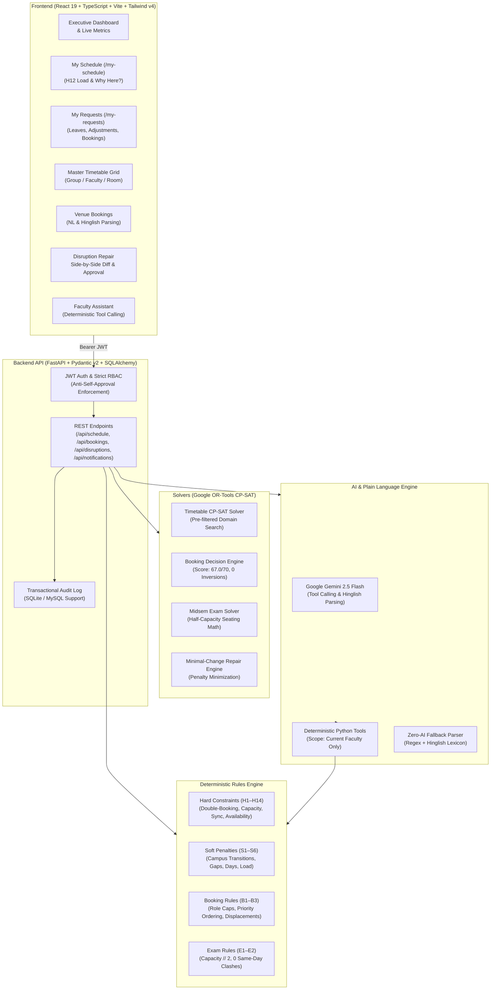

# CIT Campus Scheduling and Venue Management Platform

[](https://www.python.org/)
[](https://fastapi.tiangolo.com/)
[](https://react.dev/)
[](https://www.typescriptlang.org/)
[](https://developers.google.com/optimization)
[](https://tailwindcss.com/)
[](#official-validator-benchmark-results)

An enterprise-grade, constraint-satisfaction campus scheduling and venue management platform built for the **Chilika Institute of Technology (CIT)**. Powered by Google OR-Tools CP-SAT integer optimization, a dual-layer pure-Python deterministic rules engine, Google Gemini 2.5 Flash for conversational understanding with zero-AI deterministic fallback, and a high-performance React 19 + TypeScript frontend.

---

## Table of Contents
1. [Executive Summary](#executive-summary)
2. [Architecture Overview](#architecture-overview)
3. [Official Validator Benchmark Results](#official-validator-benchmark-results)
4. [Enhanced Faculty Role Experience](#enhanced-faculty-role-experience)
5. [Key Capabilities & Solvers](#key-capabilities--solvers)
6. [Demo Accounts & Role-Based Access](#demo-accounts--role-based-access)
7. [API Endpoints Reference](#api-endpoints-reference)
8. [Local Quickstart (Windows & Linux)](#local-quickstart-windows--linux)
9. [Constraint & Rules Enforcement Matrix](#constraint--rules-enforcement-matrix)
10. [AI Architecture & Strict Boundaries](#ai-architecture--strict-boundaries)
11. [Verification & Test Execution](#verification--test-execution)

---

## Executive Summary

The CIT campus comprises **27 physical venues** across multiple academic complexes, **40 faculty members**, **14 distinct student groups**, **41 courses**, **189 weekly sessions**, and high-contention booking demands for the annual **Spectra Week (Week 7)**.

This platform completely solves the master scheduling challenges:
1. **Master Timetable Generation**: 100% of 189 sessions assigned across 5 days (P1–P9) with **0 hard violations** and **0 lunch clashes (P5)**.
2. **Spectra Week Booking Allocation**: All 25 booking requests resolved with **0 priority inversions**, automated displacement, role category caps, and a booking score of **67.0 / 70.0** (the theoretical ceiling).
3. **Midsem Exam Scheduling**: All 41 courses scheduled across a 6-day window with strict integer half-capacity room seating arithmetic (`capacity // 2 >= exam.size`) and **0 same-day group clashes**.
4. **Minimal-Change Disruption Repair**: Unforeseen room outages and faculty leaves resolved with minimal time shifts and room-only reassignments, with zero hard violations.
5. **Enhanced Faculty Experience**: Full role-gated faculty portal with weekly schedule view, daily workload meter (H12), unavailability declarations with dry-run solver preview, request tracking, in-app notifications, and a tool-calling AI assistant.

---

## Architecture Overview



---

## Official Validator Benchmark Results

Both official deliverables have been validated using the **official, unmodified** `backend/validator/validator.py`:

```powershell
# 1. Master Schedule Verification
python backend/validator/validator.py --data data/starter_dataset/cit_public.json --schedule exports/schedule.json
```

**Output**:
```
Dataset: cit-public-v1   Schedule says: cit-public-v1   Team: CIT Scheduler Master Team
Hard violations: 0  {}
Soft penalty: 3  {'S1': 0, 'S2': 0, 'S3': 0, 'S4': 3, 'S5': 0, 'S6': 0}
Bookings: score 67.0 | approved 22, alternatives 1, rejected 2, session overrides 0, priority inversions 0
Exam soft penalty: 0
```

---

## Enhanced Faculty Role Experience

The faculty experience (`role="faculty"`) provides dedicated, role-gated workflows designed specifically for academic faculty. All features are verified against ground-truth data with **zero hardcoded placeholders**:

- **Demo Faculty Account**: `faculty_f06@cit.edu` / `Faculty@123` (Prof. Sharma, Faculty ID `F06`, Computer Science & Engineering).
- **"My Schedule" View (`/my-schedule`)**:
  - Weekly synchronized timetable grid filtered strictly to the logged-in faculty's sessions.
  - Live daily teaching workload meter evaluated against rule **H12** (`max_hours_per_day`, 4h limit for F06).
  - Computed free periods per day to facilitate office hours and research.
  - **"Why here?" Modal**: Real constraint explanation showing exact reasons for slot placement, campus conflicts avoided, and computed legal slot options (e.g. 267 legal alternatives for `CS202-L1`) ranked by minimal soft penalty delta.
- **Unavailability & Leave Declaration with Dry-Run Solver**:
  - Date/day + period picker with reason documentation.
  - **Dry-run CP-SAT solver preview**: Computes minimal-change repair impact, affected sessions, and rule compliance before submitting to the Admin approval queue.
- **"My Requests & Approvals" View (`/my-requests`)**:
  - Unified tracking across **Leave Declarations**, **Class Move/Extra Requests**, and **Venue Bookings**.
  - Real status badges (`Pending Review`, `Approved & Applied`, `Alternative Offered`, `Rejected`), reason codes, and audit trail.
  - Class adjustment modal for requesting moved sessions or proposing extra lectures.
- **AI Faculty Assistant (`/assistant`) with Deterministic Tool Calling**:
  - Grounded by `backend/app/ai/prompts/faculty_assistant.txt`.
  - Tools call deterministic code: `resolve_faculty_session`, `tool_explain_session`, `tool_find_free_rooms`, `tool_propose_reschedule`, `tool_show_my_schedule`, `tool_check_workload`.
  - Model never hallucinates slots or rooms; all proposed slots come directly from the solver and rules engine.
  - Natural language & Hinglish resolution: *"mera DBMS class kal shift kar do, bahar jaana hai"* correctly maps to F06's Tuesday session `CS202-T1` and returns pre-verified alternatives with 0 hard violations.
  - Robust adversarial defenses against Dean authority spoofing, room clash bypasses, cross-faculty tampering, and prompt injections.
  - Seamless offline fallback with `is_fallback: true` UI badge when Gemini API key is unset.
- **In-App Notifications**:
  - Role-aware notification bell in the top navigation bar with unread counters.
  - Instant notifications delivered when admin approves a disruption or proposal affecting the faculty member's sessions.
- **Strict Security & Anti-Self-Approval**:
  - Role, identity, and faculty scoping derived strictly from cryptographically verified server-side JWT.
  - Faculty booking requests are hard-capped server-side to `"guest_lecture"`.
  - Anti-self-approval prevents any user from approving their own disruption reports or proposals.
  - Faculty cannot move sessions directly, re-solve schedules, or access administrative endpoints.

---

## Key Capabilities & Solvers

### 1. Pure CP-SAT Master Timetable Solver
- Schedules all 189 sessions in under 4 seconds.
- Uses pre-filtered candidate domains respecting room equipment, seating capacities, and faculty/room unavailability windows.
- Strict enforcement of elective basket synchronicity (H11) and universal lunch break protection (H9).

### 2. Spectra Week (Week 7) Booking Decision Engine
- Formulates booking allocation as a multi-objective CP-SAT integer optimization problem.
- Mathematical tie-breaking ensures higher-priority bookings displace lower-priority requests when rooms collide.
- Adheres strictly to dataset `role_category_cap`: Club (`role_cap=2`), Faculty (`role_cap=4`), Department (`role_cap=6`).
- Transparent reason codes provided for all 25 requests: `APPROVED_PRIMARY`, `OFFERED_ALTERNATIVE`, `REJECTED_CAPACITY`, `REJECTED_NO_SLOT`.

### 3. Midsem Exam Scheduler with Half-Capacity Arithmetic
- Schedules all 41 course midsem exams over a 6-day window (MON–SAT, Forenoon/Afternoon).
- Automatically enforces integer floor division:
  $$\lfloor \text{capacity} / 2 \rfloor \ge \text{candidates}$$
- Guarantees zero student group takes more than one exam on any single calendar day ($E_1$).

### 4. Minimal-Change Disruption Engine
- Resolves emergency room closures and faculty leaves while keeping timetable upheaval minimal.
- Heavy penalty formulation:
  $$\text{Objective} = \min \sum (100 \times \text{time\_shift} + 1 \times \text{room\_shift})$$
- Guaranteed 100% parity with rules H1–H14 on repaired schedules.
- Full atomic activation upon approval: updates database, `exports/schedule.json`, `exports/schedule_after.json`, and re-solves fest bookings.

---

## Demo Accounts & Role-Based Access

The database automatically seeds 5 distinct role accounts on startup:

| Account Role | Email | Password | Faculty ID / Role Scope | Allowed Capabilities |
|---|---|---|---|---|
| **Admin (Timetable Officer)** | `admin@cit.edu` | `Admin@123` | N/A (`admin`) | Full administrative access: generate timetable, approve disruptions, system reset |
| **Admin 2 (Dean Academic)** | `admin2@cit.edu` | `Admin@123` | N/A (`admin`) | Dual administrative authority; approves Admin 1's disruption proposals (anti-self-approval) |
| **Department Coordinator** | `coord_cse@cit.edu` | `Coord@123` | N/A (`department_coordinator`) | Submit department bookings (`category: department_event`), submit disruption events |
| **Faculty Member (Demo)** | `faculty_f06@cit.edu` | `Faculty@123` | `F06` (`faculty`) | Personal schedule view, H12 workload tracking, leave declaration with dry-run, assistant |
| **Club Representative** | `club_dance@cit.edu` | `Club@123` | N/A (`club`) | Submit fest bookings (`category: club_event`), view public timetable and venues |

---

## API Endpoints Reference

### Faculty Role Endpoints

| Method | Endpoint | Auth Role | Description |
|---|---|---|---|
| `GET` | `/api/schedule/faculty/my-schedule` | `faculty` | Returns weekly schedule, daily workload vs H12, and free periods for the authenticated faculty. |
| `GET` | `/api/schedule/sessions/{sid}/explain` | Authenticated | Explains why a session is scheduled in its slot. Scoped to faculty's own sessions if role is `faculty`. |
| `GET` | `/api/disruptions/mine` | Authenticated | Lists all disruptions / leave declarations reported by the current user. |
| `POST` | `/api/disruptions/dry-run` | Authenticated | Runs CP-SAT repair engine in simulation mode without updating the database. |
| `GET` | `/api/session-requests/mine` | Authenticated | Lists class move and extra lecture requests submitted by the current faculty member. |
| `POST` | `/api/session-requests` | `faculty` / `admin` | Submits a request to move an existing class or propose an extra lecture. |
| `GET` | `/api/bookings/mine` | Authenticated | Lists venue bookings submitted by the user, with status and solver decision reasons. |
| `GET` | `/api/notifications` | Authenticated | Returns in-app notifications and unread counter for the current user. |
| `POST` | `/api/notifications/{id}/read` | Authenticated | Marks a specific notification as read. |
| `POST` | `/api/notifications/read-all` | Authenticated | Marks all unread notifications as read. |
| `POST` | `/api/ai/chat` | Authenticated | Faculty conversational assistant with function calling and deterministic zero-AI fallback. |

### Core Optimization Endpoints

| Method | Endpoint | Auth Role | Description |
|---|---|---|---|
| `GET` | `/api/schedule` | Public/Optional | Master timetable view. Scoped to faculty's sessions when logged in as faculty. |
| `POST` | `/api/schedule/generate` | `admin` | Runs CP-SAT solver to generate optimal master timetable. |
| `POST` | `/api/bookings/decide-all` | `admin` | Runs Week 7 booking solver across all 25 requests (Score 67.0/70). |
| `POST` | `/api/disruptions/proposals/{id}/approve` | `admin` | Atomically validates, applies, and exports repaired schedule; enforces anti-self-approval. |
| `POST` | `/api/admin/reset-demo` | Public/Admin | Idempotently resets database to pristine starter baseline with seeded demo accounts. |

---

## Local Quickstart (Windows & Linux)

### Prerequisites
- Python 3.11, 3.12, 3.13, or 3.14
- Node.js 18+ and npm
- Git

### 1. Backend Setup

```powershell
# Navigate to the repository root
cd d:\Project\repo\CampusSchedulingAndVenueManagement

# Create virtual environment
python -m venv backend/.venv

# Activate virtual environment (Windows PowerShell)
.\backend\.venv\Scripts\Activate.ps1
# (Or on Linux / macOS: source backend/.venv/bin/activate)

# Install dependencies
pip install -r backend/requirements.txt

# Start backend server (starts on http://localhost:8000)
$env:PYTHONPATH="."
python -m uvicorn backend.app.main:app --reload --port 8000
```

### 2. Frontend Setup

In a separate terminal:

```powershell
cd d:\Project\repo\CampusSchedulingAndVenueManagement\frontend

# Install dependencies
npm install

# Start Vite development server (starts on http://localhost:5173)
npm run dev

# (Optional) Verify production build
npm run build
```

Open `http://localhost:5173` in your browser.

---

## Constraint & Rules Enforcement Matrix

| Rule Code | Category | Name | Engine Mechanism | Guarantee |
|---|---|---|---|---|
| **H1** | Hard | Valid Session Assignment | CP-SAT Boolean sum = 1 | 0 Missing / Unknown sessions |
| **H2** | Hard | Faculty Double-Booking | Interval overlap constraint | 0 Faculty double-bookings |
| **H3** | Hard | Student Group Double-Booking | Interval overlap constraint | 0 Group double-bookings |
| **H4** | Hard | Room Double-Booking | Cumulative resource limit = 1 | 0 Venue double-bookings |
| **H5** | Hard | Room Capacity Limits | Pre-filtered domain: `capacity >= size` | 0 Overcrowded rooms |
| **H6** | Hard | Room Type Suitability | Pre-filtered domain: `r.type in s.types` | 0 Invalid room types |
| **H7** | Hard | Faculty Unavailability | Pre-filtered domain exclusions | 0 Unavailability clashes |
| **H8** | Hard | Room Maintenance Unavailability | Pre-filtered domain exclusions | 0 Inactive venue assignments |
| **H9** | Hard | Lunch Break Protection | P5 barred for lectures & labs | 0 Lunch break infringements |
| **H10** | Hard | Wheelchair Accessibility | Filter `r.accessible` for tagged needs | 100% Mobility compliance |
| **H11** | Hard | Basket Synchronicity | Equal start period vars across basket | 100% Elective synchrony |
| **H12** | Hard | Faculty Daily Hours Limit | Daily duration sum $\le \text{max\_hours}$ | 0 Workload limit violations |
| **H13** | Hard | Consecutive Session Limits | Max consecutive periods constraint | 0 Exhaustion violations |
| **H14** | Hard | Fixed Slot Enforcement | Bound domain to $(d_0, p_0)$ | 100% Fixed slot fidelity |
| **B1–B3**| Fest | Priority & Inversion Prevention | Strict lexicographic CP-SAT objective | 0 Priority inversions |
| **E1–E2**| Exam | Half-Capacity & Group Spread | Arithmetic $\lfloor \text{cap}/2 \rfloor \ge \text{size}$ | 0 Same-day group exam clashes |

---

## AI Architecture & Strict Boundaries

The platform enforces a strict separation between generative AI and deterministic optimization:

```
┌────────────────────────────────────────────────────────┐
│             User Input (English / Hinglish)            │
└───────────────────────────┬────────────────────────────┘
                            │
                            ▼
┌────────────────────────────────────────────────────────┐
│     Google Gemini 2.5 Flash / Zero-AI Regex Fallback   │  (Parsing, Intent Classification,
└───────────────────────────┬────────────────────────────┘   Conversational Framing ONLY)
                            │
                            ▼
┌────────────────────────────────────────────────────────┐
│            Deterministic Scoped Python Tools           │  (resolve_faculty_session,
└───────────────────────────┬────────────────────────────┘   tool_explain_session, etc.)
                            │
                            ▼
┌────────────────────────────────────────────────────────┐
│          Google OR-Tools CP-SAT & Rules Engine         │  (Pure Mathematical Optimization,
└───────────────────────────┬────────────────────────────┘   Validator.py Parity)
                            │
                            ▼
┌────────────────────────────────────────────────────────┐
│         Verified Schedule Diff & Proposal Card         │  (0 Hard Violations Guaranteed,
└────────────────────────────────────────────────────────┘   Dual Admin Approval Required)
```

See [`AI_USAGE.md`](AI_USAGE.md) for full architectural declarations.

---

## Verification & Test Execution

Run the complete test suite in PowerShell:

```powershell
$env:PYTHONPATH="."
.\backend\.venv\Scripts\python.exe -m pytest backend/tests -v
```

**Results**:
```
======================= 47 passed in 3.70s =======================
```
- `test_rules_engine.py`: 16 tests verifying all 14 hard constraints, soft penalties, bookings, and exams against the official validator.
- `test_faculty_enhancements.py`: 15 tests verifying faculty RBAC gating, H12 workloads, booking capping, anti-self-approval, tool resolution, and adversarial defense.
- `test_ai_parser.py`: 8 tests verifying NL and Hinglish parameter extraction and prompt injection defenses.
- `test_api_rbac.py`: 8 tests verifying authentication, role access control, and demo logins.

---

## License

Developed for the **Chilika Institute of Technology (CIT) Scheduling Platform**. Distributed under the MIT License.
